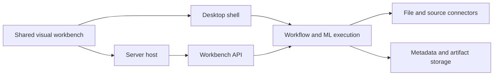

# Cross-Platform No-Code Data Science Workbench

## Plan Status

- **Status:** User-approved build baseline, with bounded authorization for the local/offline security foundation and staged workbench slices.
- **Authorized implementation scope:** code may implement the local/offline security foundation and staged workbench slices within the requirements below. This does not authorize cloud provisioning, provider-specific services or credentials, direct connector functionality, or a claim that 100+ GB workloads are supported. Those activities or claims require their relevant security and service decisions to be separately approved, then implemented and tested. Direct connector functionality remains gated on the P0 security foundation and approved connector/auth contracts; cloud-connected releases remain gated on the documented threat model, security review, tenant-isolation tests, secret-redaction tests, and approved deployment decisions.
- **Scale qualification:** datasets above 100 GB remain a confirmed product requirement; distributed remote execution is a proposed approach, not an approved or verified capability. Do not represent 100+ GB support as available until the execution path is approved, implemented, and tested.
- **Confirmed product scope:** a full no-code workbench for preparation, data mining/exploration, ML prediction, and evaluation; desktop and server are first-class. Multi-cloud is confirmed for Azure, AWS, and Google Cloud. Desktop supports local/offline single-user work and optional connection to a remote team server that requires authenticated access.
- **Confirmed platform and scale scope:** Windows, macOS, Ubuntu/mainstream Linux, and WSL2 are in scope; mobile and embedded platforms are excluded. Datasets may exceed 100 GB, with distributed remote execution as the proposed path at that scale; local capacity is hardware-dependent and is not promised at that size.
- **Confirmed connector launch scope:** CSV, Excel, Parquet; PostgreSQL, MySQL, SQL Server; S3, Azure Blob, GCS; Snowflake, BigQuery, Redshift; and generic REST, with a plugin catalog. Per source, users may link in place or copy a snapshot.
- **P0 security foundation:** security, authentication, and authorization requirements in [P0 Security Foundation](#p0-security-foundation) precede direct connector functionality and any cloud-connected release. Specific identity/secret products, compliance and residency requirements, limits, and service implementations remain approval decisions.
- **Proposed defaults, not approved architecture:** current maintained OS versions at release; provider-neutral core contracts with provider adapters; reproducible workflow/job contracts; and administrator-configurable retention/deletion.
- **Still requires approval:** identity provider and service choices, cloud service selections, compliance/data-residency requirements, precise algorithm and metric list, user/concurrency and retention targets, and deployment details, plus the other decisions listed under [Open Decisions](#open-decisions). Confirmed providers and connector scope do not select cloud services or approve an architecture.
- **Authorization boundary:** the approved baseline authorizes only local/offline security-foundation code and staged workbench code. It authorizes no infrastructure or deployment configuration, cloud resources, provider-specific services or credentials, direct connector functionality, or unverified 100+ GB support claims; those remain gated as described above.

## Product Goal

Deliver a cross-platform, no-code data science workbench that lets users bring data in, prepare and explore it, apply data-mining and machine-learning workflows, make predictions, evaluate results, and retain direct references to or copies of their data. Desktop and server are co-equal targets. Desktop supports local execution and offline work, with an optional connection to a remote server. Multi-cloud operation across Azure, AWS, and Google Cloud is confirmed. Provider-neutral core contracts with provider adapters are a proposed default, not approved architecture. Datasets may exceed 100 GB; distributed remote execution is the proposed path at that scale, while local execution has finite, hardware-dependent limits and is not promised to handle every workload.

## Approved Requirements

- Support desktop and server operation as co-equal product targets from the first milestone.
- Deliver a full no-code workbench across data preparation, data mining/exploration, ML prediction, and evaluation; desktop and server are first-class from the first milestone.
- Support the confirmed launch connectors: CSV, Excel, Parquet; PostgreSQL, MySQL, SQL Server; S3, Azure Blob, GCS; Snowflake, BigQuery, Redshift; and generic REST. Include a plugin catalog. Exact operations, auth methods, and plugin behavior remain to be specified; this scope does not promise universal vendor coverage.
- Provide drag-and-drop dataset intake and let users choose linked-in-place access or a copied snapshot for each supported source, subject to source capabilities.
- Support personal single-user desktop use, including local/offline use, and optional connection to a remote server with authenticated team access. Hosted server access requiring team login is compatible with personal offline desktop use.
- Target multi-cloud operation across Azure, AWS, and Google Cloud. No cloud service selection is implied.
- Support datasets that may exceed 100 GB. Distributed remote execution is the proposed approach, subject to approval; local capacity remains hardware-dependent and may be smaller.
- Provide visual, no-code interaction for building and running data workflows.
- Make the end-to-end experience usable without coding: guide users through import, inspection, preparation, execution, and result interpretation; provide sensible defaults, recommend next actions, and clearly explain missing values and other data-quality issues.
- Keep large-data inspection responsive by returning schema, sample, and profile information progressively and showing paginated previews instead of requiring full-dataset materialization in the UI.
- Use memory-aware processing. For remote connectors, prefer lazy or streaming scans and push filters, projections, and other supported operations down to the source rather than transferring full datasets unnecessarily.
- Keep desktop execution local-first, including when offline, wherever the selected source and workflow are available locally. For server/cloud jobs, run asynchronously and provide progress, cancellation where supported, retry behavior, and clear actionable errors.
- Make snapshot transfers resilient to weak or unstable connections with resumable, chunked uploads and configurable transfer throttling. Cache source metadata and samples where appropriate, and avoid repeatedly transferring full datasets for inspection or reruns.
- Prefer compute near a remote data source when supported and make local capacity constraints and estimated transfer and job costs understandable before users start work. Cost estimates are informational and must not imply unapproved cloud services or exact billing guarantees.
- State the physical transfer limit plainly: a 100+ GB local file still takes time to transfer over a weak link. Do not promise instant cloud use; offer local execution, in-place remote processing where supported, or resumable transfer as alternatives.

## P0 Security Foundation

Security, authentication, and authorization are a P0 foundation, ahead of direct connector functionality and cloud deployment. These are product requirements, not provider or service selections. Complete the security design and validation before implementing direct connector access or treating a deployment/cloud-connected release as ready.

- Hosted team access uses OIDC/OAuth2-based authentication. Delegate MFA to the selected identity provider; the product must not implement its own MFA. The identity provider and protocol profile/configuration require approval.
- Enforce RBAC and isolation by user, team, and project. Apply authorization on every dataset, workflow, job, model, artifact, and connector endpoint, including reads, writes, execution, sharing, and deletion. Default to least privilege and deny access when authorization is absent or fails.
- Store connector credentials only in the desktop OS keychain/local secure store or an approved server-side secret manager. Never place credentials in workflow JSON, project exports, logs, or ordinary application data. Redact secrets from errors and diagnostics.
- Protect data in transit with TLS and encrypt stored data at rest. Select algorithms, key management, and concrete implementations only through later approval.
- Audit authentication, authorization/access, connector, and job actions. Define audit access, retention, and tamper-protection expectations through approval; do not log credential values or tokens.
- Use secure session and token handling, including protected storage, bounded lifetimes, rotation/refresh and revocation behavior, and logout invalidation. Enforce CSRF protections for cookie-authenticated state changes and explicit CORS origin/method/header boundaries.
- Validate uploads by content and size, reject unsafe or unsupported inputs, and enforce configurable quotas before processing. Isolate connector and job processes with least privilege and resource limits so untrusted data, plugins, and workloads cannot access unrelated projects or host resources.
- Provide data retention and deletion controls for source copies, caches, jobs, models, artifacts, and audit records, with deletion behavior and guarantees subject to approval.
- Offline desktop has no telemetry or data egress by default. Any optional network behavior must be explicit, user-controlled, and disclosed; offline workflows must not silently send data or diagnostics.

**Release gate:** a deployment or cloud-connected release is not ready without a documented threat model, completed security review, passing tenant-isolation tests, and passing secret-redaction tests. Security acceptance must also verify endpoint authorization, least privilege, transport/storage protections, audit coverage, and the offline no-egress default. Provider-specific identity, secret, storage, key-management, or policy products are not selected by these requirements.

## Proposed Product Shape

The workbench is organized around a visual project containing data references, datasets, transformation steps, analysis and modeling steps, run history, predictions, and evaluation results. Users compose and run workflows through the UI rather than writing code. Workflow definitions should be serializable and versioned so they can be saved, reopened, and moved between desktop and server modes, subject to compatible engine and connector versions. Security controls in [P0 Security Foundation](#p0-security-foundation) apply across both modes and must precede direct connector functionality and cloud-connected releases.

### Operating Modes

- **Desktop:** personal single-user application for local/offline work, with hardware-dependent local execution limits and optional connection to a remote team server. Proposed supported platforms are Windows, macOS, Ubuntu/mainstream Linux, and WSL2; mobile and embedded are excluded. Specific OS versions and offline feature/parity details require approval.
- **Server:** remotely accessible workbench with authenticated team access and job execution. Distributed remote execution is the proposed route for workloads above 100 GB. Hosted team access must meet the OIDC/OAuth2, MFA-delegation, RBAC, and user/team/project isolation requirements in [P0 Security Foundation](#p0-security-foundation). Identity provider and implementation details, deployment form, and server OS/package details require approval.
- **Multi-cloud:** Azure, AWS, and Google Cloud are confirmed target providers. Provider-neutral core contracts with provider adapters are a proposed design default, not an approved architecture. No provider-specific managed service is selected.

### Proposed Operational Defaults (Approval Required)

These conservative defaults guide requirements refinement only; they do not authorize an architecture, implementation, or deployment.

- Target current maintained versions of Windows, macOS, Ubuntu/mainstream Linux, and WSL2 at release; approve the exact version matrix before release commitments.
- Keep core contracts provider-neutral and add provider adapters where provider-specific integration is needed.
- Meet the mandatory security baseline in [P0 Security Foundation](#p0-security-foundation); specific identity, key-management, and secret-storage products remain unselected pending approval.
- Define reproducible, versioned workflow and job contracts shared across desktop and server where compatible.
- Make retention and deletion administrator-configurable on the server; approve concrete targets and guarantees separately.
- Route workloads above 100 GB to distributed remote execution when supported. Publish hardware-dependent local limits rather than promising that scale on desktop.

### Proposed Component Boundaries

- **Shared UI:** build on the existing React/TypeScript/Vite scaffold for the browser-facing workbench. Reuse the UI in the desktop package where technically suitable.
- **Portable core and packaging:** proposed default is versioned, reproducible contracts for projects, workflows, jobs, connectors, and artifacts. Desktop/server packaging and exact supported OS versions remain unapproved. Containers are not a commitment to a hosting product and do not remove local hardware or memory limits.
- **Workbench API:** expose project, dataset, workflow, job, prediction, and evaluation operations through a versioned application boundary. Keep product-domain contracts independent of hosting-provider SDKs.
- **Execution engine:** execute the same versioned workflow model in local and server contexts where practical. Separate UI orchestration from potentially long-running jobs, and report progress, cancellation, errors, and outputs consistently. Engine language/runtime and job isolation model are open decisions.
- **Connector boundary:** the confirmed launch set is CSV/Excel/Parquet; PostgreSQL/MySQL/SQL Server; S3/Azure Blob/GCS; Snowflake/BigQuery/Redshift; and generic REST, with a plugin catalog. Specify operations, auth methods, mode support, and plugin contracts before implementation. The proposed credential defaults are in [Proposed Operational Defaults (Approval Required)](#proposed-operational-defaults-approval-required).
- **Persistence boundary:** keep project metadata, workflow definitions, datasets, model artifacts, and run outputs behind replaceable storage interfaces. Specific database and file/object storage products are unselected.

This is an illustrative logical proposal, not an approved architecture or deployment topology. Desktop-to-server behavior, process boundaries, concrete technologies, and provider service mappings require explicit approval.

## First Milestone: Full Workbench

The first milestone is a full no-code workbench across preparation, mining/exploration, prediction, and evaluation, with desktop and server as first-class modes. The bounded initial acceptance scope is the confirmed OS families and connector launch set in this plan, a complete visual workflow through evaluated results, personal offline desktop use, and authenticated team-server use. The exact algorithms/metrics, supported OS versions, per-connector operations, offline parity, and service/deployment choices must be approved before they become release commitments. Distributed remote execution for workloads above 100 GB is the proposed acceptance target, not an approved architecture or local desktop guarantee.

- Create, save, reopen, and organize projects and visual workflows.
- Drag and drop supported datasets into a project; inspect schema, types, missing values, and basic data quality/profile summaries.
- Retain source metadata and make copy-versus-in-place linkage explicit, with clear behavior when a source moves, credentials expire, or access is revoked.
- Compose and preview common preprocessing steps, including filtering, column selection/renaming, type conversion, missing-value handling, and derived columns.
- Perform exploratory analysis and agreed data-mining workflows with visual summaries and inspectable outputs.
- Train supported baseline models, generate predictions, and report agreed evaluation metrics with reproducible run inputs and outputs.
- Show run status, progress, errors, and history; allow cancellation where supported.
- Run the approved offline subset locally in desktop mode and submit/run compatible workflows in authenticated server mode. Publish hardware-dependent local limits; distributed remote execution for supported workloads above 100 GB remains subject to approval.
- Keep schema, samples, profiles, and paginated previews useful on large datasets without loading the full dataset into the UI; use memory-aware local processing and lazy/streaming scans with query pushdown for supported remote connectors.
- For snapshot imports over unreliable links, support resumable/chunked transfer and throttling. Reuse cached metadata and samples where valid, avoid unnecessary full-dataset transfers, and explain transfer time, local capacity constraints, and estimated job/transfer costs before execution where estimates are available.
- For long-running server/cloud work, provide asynchronous job status and progress, cancellation where supported, retry behavior for recoverable failures, and clear errors that identify the issue and a next action. Prefer compute near the source when the connector and approved execution environment permit it.
- Explicitly explain that moving a 100+ GB local file over a weak connection takes time; offer local execution, supported in-place remote processing, or resumable transfer rather than suggesting that cloud use will be instant.
- Provide documentation for installing/starting each agreed mode and for optionally connecting desktop to a server.

Acceptance is bounded to the named launch connectors and OS families, without an implied promise of every connector capability or provider service. Exact transform, algorithm, metric, connector-operation, offline-parity, local-limit, and OS-version criteria must be approved. Concurrency/retention targets and deployment details also remain open.

## Milestone Plan

1. **P0 security foundation:** define the threat model and security architecture requirements, establish endpoint-level authorization and isolation criteria, and prepare validation for the security baseline. This precedes direct connector functionality and cloud deployment. Provider-specific products are not selected here.
2. **Resolve remaining requirements and architecture:** approve the identity provider and secret-management implementation, compliance/data-residency requirements, user/concurrency/retention targets, cloud service selections and deployment details, exact OS versions/package matrix, connector operations/plugin contracts, local/offline limits and parity, algorithm/metric list, and distributed execution requirements. Do not treat this plan as approval of an architecture.
3. **Portable foundation:** after explicit approval, define reproducible project/workflow/job contracts, provider-neutral core boundaries and provider adapters, persistence, source handling, and desktop/server compatibility rules without assuming provider services. Implement security controls before direct connector access.
4. **Integrated workbench:** deliver dataset intake and profiling, visual preprocessing, analysis/data mining, model training, prediction, evaluation, and run history as one end-to-end workflow, with the P0 security baseline applied to connector and data operations.
5. **Desktop and server readiness:** package and validate both operating modes on the approved OS matrix; verify offline behavior and no-egress default, documented local limits, workflow compatibility, security controls, failure recovery, and operational documentation.
6. **Multi-cloud deployment decision:** Azure, AWS, and Google Cloud are confirmed targets. A deployment/cloud-connected release cannot be considered ready until the threat model, security review, tenant-isolation tests, and secret-redaction tests pass. After data residency, identity, security, tenancy, cost, service selection, and deployment requirements are approved, create a separate deployment plan and service mapping for each provider. No provider-specific service choice or cloud infrastructure is included in this artifact.

## Acceptance Criteria

- A user can complete the approved end-to-end no-code workflow across preparation, mining/exploration, prediction, and evaluation in desktop and server modes for the bounded launch connector set; offline coverage and compatibility limits are explicit.
- A user can import a dataset by drag and drop, inspect it, apply supported transforms, analyze it, train an approved model, produce predictions, and view agreed evaluation results.
- A novice can complete import, inspection, preparation, execution, and result interpretation without writing code; the workbench supplies guided steps and sensible defaults, recommends next actions, and clearly explains missing-value and data-quality issues.
- Large-dataset inspection is progressive and paginated; the UI does not require full-dataset loading to show schema, samples, or profile summaries. Supported local processing is memory-aware, and supported remote connectors use lazy/streaming scans and query pushdown where possible.
- Snapshot transfer can resume after interruption and can be throttled. Metadata and samples are reused where valid to avoid repeated full-dataset transfers; capacity, estimated transfer time, and estimated job/transfer costs are communicated before execution where available.
- A 100+ GB local file on a weak link is not presented as instantly available in the cloud. The user is offered local execution, supported in-place remote processing, or resumable transfer, with the limitations of each made clear.
- Long-running server/cloud jobs are asynchronous and expose progress, cancellation where supported, recoverable retry behavior, and clear actionable errors. Execution prefers compute near the remote source when supported and approved.
- Projects clearly distinguish linked sources from copied/imported data and follow the approved source lifecycle behavior.
- Workflow and run records capture enough version/configuration information to explain and reproduce results within the supported environment.
- The same project can be opened in desktop and server modes when engine, connector, and execution requirements are compatible; incompatibilities and local-limit constraints are reported rather than silently changing results.
- If approved, supported workloads above 100 GB use a distributed remote execution route; desktop local capacity is hardware-dependent and may be smaller.
- The workbench passes the explicitly approved OS/version and packaging matrix, including install, update, backup, and recovery expectations.
- The P0 security baseline is verified before direct connector functionality: hosted OIDC/OAuth2 authentication with MFA delegated to the identity provider; RBAC and user/team/project isolation; authorization on every dataset/workflow/job/model/artifact/connector endpoint; least privilege; approved credential storage with no secrets in workflow JSON/logs; TLS in transit and encryption at rest; audit coverage; secure session/token handling; CSRF/CORS boundaries; upload validation/quotas; process isolation; retention/deletion controls; and offline no-egress by default.
- A deployment/cloud-connected release passes the documented threat-model gate, security review, tenant-isolation tests, and secret-redaction tests. Detailed identity provider, compliance/data-residency, limits, and concrete service implementations remain unselected until approved.
- Server retention/deletion behavior follows approved targets; the security baseline itself is required and is not merely a proposed default.
- Provider-neutral core contracts and adapters are the proposed design default. The approved launch connector scope is named in this plan; specific operations and plugin behavior remain approval items.

## Non-Goals for This Plan

- Choosing or provisioning a cloud provider, cloud region, managed services, or infrastructure-as-code.
- Selecting a database, object store, identity provider, secrets manager, or compute vendor.
- Committing to specific third-party data-source vendors or connector credentials.
- Promising every operating system, file format, algorithm, scale, or hardware accelerator before the requirements are agreed.
- Adding code to the current scaffold as part of this planning task.

## Risks and Controls

- **Desktop/server parity:** local and server execution may differ in dependencies, filesystem access, or hardware. Define one workflow contract and test compatibility explicitly; surface unsupported steps instead of silently substituting behavior.
- **Large or sensitive datasets:** >100 GB workloads require distributed/cloud execution and can involve substantial transfer, storage, and processing costs. Define realistic local limits and resolve residency, privacy, copy/link, retention, and deletion policies before selecting storage or hosting.
- **Weak networks and transfer expectations:** a large local file cannot be made instantly available remotely over a slow link. Provide local execution, supported in-place remote processing, or resumable/chunked transfer with throttling; cache reusable metadata/samples, explain estimates and local capacity, and avoid unnecessary full-data movement. Exact estimate methodology and transfer limits need approval.
- **Remote source links:** links can become stale and credentials can expire. Distinguish durable source metadata from secrets and define reconnect/re-authentication behavior.
- **No-code scope breadth:** preprocessing, data mining, and ML span a large feature set. Approve a bounded first set of operations and measurable evaluation metrics while retaining the full-workbench milestone.
- **Multi-cloud and connector breadth:** Azure, AWS, and Google Cloud and the bounded launch connector set are confirmed. Portability does not make provider services or every connector capability interchangeable; cloud service selections, connector operations, and plugin behavior still need approval.
- **Offline parity and packaging:** offline work, local limits, native desktop capabilities, and server packaging vary. Approve an explicit feature/parity contract and OS/version/package matrix before promising support.
- **Security and isolation:** connector credentials, sensitive datasets, plugins, and team data create high-impact exposure risks. Put the P0 security baseline before connector functionality; require endpoint authorization, process isolation, auditability, and the stated deployment release gates.

## Open Decisions

These questions must be answered before architecture, implementation, or deployment are treated as approved. Confirmed scope includes Azure, AWS, and Google Cloud; the named connector launch set and plugin catalog; Windows, macOS, Ubuntu/mainstream Linux, and WSL2; personal offline desktop plus authenticated team server; linked-in-place or copied-snapshot data handling; and distributed remote execution for supported workloads above 100 GB.

1. **Cloud services and deployment:** Which Azure, AWS, and Google Cloud services, regions, deployment models (managed, customer-managed, private, hybrid), and data-residency options are approved? Service selections and deployment details remain open.
2. **Connector contracts:** For the confirmed launch set (CSV/Excel/Parquet; PostgreSQL/MySQL/SQL Server; S3/Azure Blob/GCS; Snowflake/BigQuery/Redshift; generic REST), define supported operations, authentication, desktop/server support, source limitations, and plugin catalog behavior.
3. **Identity implementation and security operations:** The P0 security baseline is required as specified above. Approve the identity provider and OIDC/OAuth2 profile/configuration, RBAC role definitions, audit access/retention and tamper-protection expectations, encryption/key-management implementation, secret-manager products, regulated-data controls, and desktop/server credential-storage implementations. MFA is delegated to the selected identity provider. Compliance and data-residency requirements remain open; no provider-specific identity or secret product is selected.
4. **Operating systems and packaging:** Approve exact current-maintained-at-release OS versions, server OSes, installer/package formats, update/support expectations, and whether containers are required or preferred. Mobile and embedded platforms are out of scope.
5. **Local/offline limits and parity:** Define offline capabilities, source availability, sync/queue behavior, supported workflows/connectors offline, measured local limits (dataset size, memory/storage, runtime, hardware), and desktop/server compatibility guarantees.
6. **Data lifecycle:** Linked-in-place and copied-snapshot modes are confirmed. Define refresh/snapshot semantics, caching, stale-link handling, credential expiry/revocation, deletion behavior, and which mode is available for each source.
7. **Team tenancy:** Confirm user/team/project ownership semantics, detailed RBAC role definitions, isolation boundaries, administration, collaboration, and how optional desktop-to-server identity works. Required user/team/project isolation is a P0 baseline; exact tenancy behavior is an approval decision.
8. **Scale, users, concurrency, and retention targets:** Confirm user limits, workload and job-duration targets, concurrent users/jobs, performance expectations, quotas, run/artifact retention, and deletion windows. Above 100 GB calls for distributed remote execution; no local desktop scale guarantee is made.
9. **Large-data usability and network thresholds:** Approve measurable latency/preview targets, memory and local-capacity guidance, query-pushdown behavior by connector, cache validity, transfer throttling defaults, retry/resume rules, and how transfer/job cost estimates are calculated. The product must not imply that a 100+ GB local file transfers instantly over a weak link; local execution, in-place remote processing, and resumable transfer are the user-facing alternatives.
10. **Precise algorithm and metric list:** Approve launch data-mining methods, model families, prediction tasks, and evaluation metrics, including whether time-series, clustering, anomaly detection, or explainability are required.
11. **Deployment and product acceptance:** Approve who operates server instances and logging, monitoring, backup/restore, support, and upgrade expectations. Approve the bounded acceptance criteria and proposed defaults before architecture, code, infrastructure, or deployment work is authorized. This decision list is an approval gate, not authorization to proceed.
